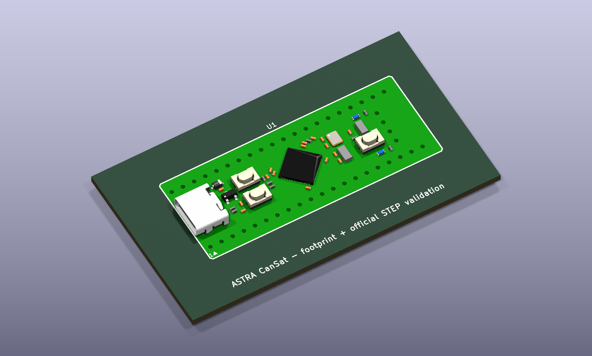

# KiCad Library for WeAct Studio Black Pill STM32F411CEU6 V3.0 / V3.1

[](https://www.kicad.org/)
[](docs/VALIDATION.md)
[](LICENSE)

Reusable KiCad symbol, through-hole footprint, and validation project for the complete **WeAct Studio MiniF4 / Black Pill module with STM32F411CEU6**. This library models the COTS board, not the bare STM32 microcontroller.

Developed and maintained by **ASTRA TEAM** for the ASTRA CanSat avionics program.

Keywords: WeAct Studio Black Pill, MiniF4, STM32F411CEU6, KiCad symbol library, KiCad footprint, STM32 development board, USB-C, SWD, V3.0, V3.1.



## Download

**[Download the complete library as a ZIP](https://github.com/edulandoni/WeAct-BlackPill-STM32F411CEU6-KiCad-Library/archive/refs/heads/main.zip)**

The ZIP already includes the KiCad symbol, footprint, validation project, documentation, screenshots, and official STEP model. No separate model download is required.

1. Click the download link above.
2. Extract the ZIP to a permanent folder.
3. Keep the extracted files together so KiCad can find the included 3D model.

## Validation status

**VALIDATED — revision 1.1 — 2026-10-12 — KiCad 10.0.7**

The library was checked against WeAct Studio's official repository at commit [`05380f5`](https://github.com/WeActStudio/WeActStudio.MiniSTM32F4x1/tree/05380f5c41f38eea8966a81c5acdeb7512cd909f):

- all 44 symbol pins match the official P1, P2, and SWD P3 connectors;
- all 44 footprint pad centers match the official V3.1 STEP hole centers within 0.001 mm (maximum observed error: 0.000566 mm);
- 2.54 mm pitch and 15.2146 mm row spacing were verified;
- the 52.81 × 20.78 mm nominal board outline and USB-C orientation were verified;
- Pin 1 is the only rectangular pad and is marked on `F.SilkS` and `F.Fab`;
- the validation project reports zero ERC violations, zero DRC violations, zero unconnected items, and zero schematic/PCB parity errors.

See [docs/VALIDATION.md](docs/VALIDATION.md) for the complete technical review and [validation/pinout_and_geometry.csv](validation/pinout_and_geometry.csv) for the 44-contact traceability matrix.

## Contents

```text
WeAct_BlackPill_STM32F411CEU6.kicad_sym     KiCad symbol library
WeAct_BlackPill_STM32F411CEU6.pretty/       KiCad footprint library
3dmodels/                                   Included official STEP model
docs/                                       Validation record, sources, and change log
validation/                                 Minimal schematic/PCB project and evidence
```

## Install the libraries

1. In KiCad, open **Preferences → Manage Symbol Libraries** and add `WeAct_BlackPill_STM32F411CEU6.kicad_sym` with the nickname `WeAct_BlackPill_STM32F411CEU6`.
2. Open **Preferences → Manage Footprint Libraries** and add `WeAct_BlackPill_STM32F411CEU6.pretty` with the same nickname.
3. In **Preferences → Configure Paths**, define `WEACT_BLACKPILL_KICAD_LIB` as the absolute path to the extracted repository directory.

The symbol already references the supplied footprint. The footprint expects:

```text
${WEACT_BLACKPILL_KICAD_LIB}/3dmodels/WeAct_MiniF4x1Cx_V31.step
```

## Open the validation project

Open `validation/BlackPill_validation.kicad_pro`, open the PCB, and press `Alt+3`. The module should appear with USB-C on the left and all 44 holes aligned with the pads. The validation PCB uses a project-relative model path, so it does not require the KiCad path variable.

Reference images are included in `validation/BlackPill_validation_3D_top.png` and `validation/BlackPill_validation_3D_iso.png`.

## Supported hardware and limitations

- Supported: original WeAct Studio MiniF4/Black Pill boards with STM32F411CEU6, revisions V3.0 and V3.1.
- The official STEP represents V3.1. V3.0 shares the documented interface geometry and pinout, but its component placement and cosmetic details are not certified by the V3.1 model.
- Clones and other board revisions are not covered.
- Header/socket height, carrier-board clearance, and USB-cable envelope remain integration-level TBDs. The STEP does not include installed headers.
- `FLASH_*`, USB, LED, button, LSE, and BOOT1 labels describe onboard shared connections; they do not remove the associated electrical loading.
- The validation project verifies library consistency, not a flight-ready electrical design.

## Official files and licensing

The included STEP is the unmodified official WeAct Studio V3.1 model. WeAct Studio confirmed to ASTRA TEAM by email that the model may be published and redistributed. Its source commit and SHA-256 are recorded in [docs/OFFICIAL_SOURCES.md](docs/OFFICIAL_SOURCES.md) and [THIRD_PARTY_NOTICES.md](THIRD_PARTY_NOTICES.md).

Official PDFs, the Altium library, and pinout artwork remain linked to their authoritative upstream locations rather than duplicated here.

The KiCad symbol, footprint, validation project, scripts, and ASTRA TEAM documentation in this repository are licensed under the [MIT License](LICENSE). WeAct Studio names, documentation, CAD models, artwork, and hardware designs remain the property of their respective owners. This project is independent and is not affiliated with or endorsed by WeAct Studio.

## Contributing

Do not change pad or pin numbering silently. Any change must identify the discrepancy, cite the official source and revision, update the traceability matrix, and regenerate the ERC/DRC evidence.
